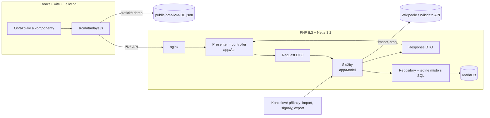

# Tento den

Každý den pět zajímavých výročí z Wikipedie – ze světa i z Česka. Mobilní webová aplikace
(PWA, hlavně iPhone v Safari) s **REST API v PHP 8.3 / Nette 3.2** a **frontendem v Reactu**.

> **Živé demo:** <https://petrstastny1.github.io/tento-den/> *(statická verze bez backendu, nasazuje GitHub Actions)*

<p>
  
  
  
</p>
<p>
  
</p>

## Co aplikace dělá

- Pro každý den roku vybere **5 výročí** z české Wikipedie: aspoň 2 z Česka (pokud existují),
  podle skóre; nudné události (sportovní výsledky, otevření obchodu, vydání softwaru…) až
  nakonec, rozmanitost století rozhoduje jen při shodném skóre.
- Listování dny (šipky, přejetí prstem, výběr data), **sdílení karty** (Web Share API,
  jinak zkopírování odkazu), **oblíbené** v prohlížeči.
- U každé karty **zdroj na konkrétní revizi** stránky dne, odkaz na autory a licenci
  CC BY-SA 4.0. Fakta se nevymýšlí ani neupravují – text je převzatý ze zdroje.
- Karty o obětech, válkách a katastrofách jsou označené jako citlivé a mají střídmější vzhled.

## Architektura



- **Backend:** Controller (Nette presenter jako API endpoint) → Service → Repository, DTO pro
  vstupy i výstupy, závislosti jen přes DI v konstruktoru, schéma jen přes migrace.
- **Import** běží jen na serveru (konzole/cron): Parsoid HTML **konkrétní revize** stránky dne,
  přísný parser (co nepřečte, shodí celý den), párování upravených vět se zachováním ID,
  nejasné změny k ruční revizi, nic se nemaže.
- **Výběr pětice (experimentální):** počet jazykových verzí článku (Wikidata) normalizovaný
  logaritmicky v rámci dne a sekce, filtr nudy jako čitelný seznam pravidel, deterministický
  výběr. Měří se na zlaté sadě a ručně hodnocených dnech ([docs/kvalita.md](docs/kvalita.md),
  [docs/experiment-vyberu.md](docs/experiment-vyberu.md)).
- **Frontend:** jedna datová vrstva se dvěma režimy (živé API / statická data), texty jen jako text,
  odkazy jen na Wikipedii. Design „almanach dne“: každý den má barvu podle ročního období,
  serifová typografie (systémové New York), skleněné plovoucí ovládání, tmavý režim, kontrast AA.

Podrobnosti a důvody: [docs/rozhodnuti.md](docs/rozhodnuti.md), zdroje dat:
[docs/zdroje.md](docs/zdroje.md), kvalita výběru: [docs/kvalita.md](docs/kvalita.md),
otázky k pohovoru: [docs/pohovor.md](docs/pohovor.md).

## Spuštění

Potřeba: Docker s Compose v2 a `make` (PHP ani Node lokálně nejsou potřeba).

```bash
make init-env            # .env s náhodnými hesly; pak doplňte WIKIMEDIA_CONTACT (e-mail do User-Agentu)
make up                  # nginx, php-fpm, MariaDB, Vite; založí i testovací DB
make migrate
make import-year         # ~10 minut: 366 stránek dnů z cs.wikipedia
make refresh-signals     # ~2 minuty: jazykové verze článků z Wikidat
```

- aplikace: <http://localhost:8080>, API: <http://localhost:8080/api/day?date=10-28>
- statická data pro demo: `make export-static` (zapíše `frontend/public/data/`)
- další příkazy: `docker compose exec php php bin/console.php` (např. `events:review` – události
  čekající na ruční rozhodnutí), ověřovací reporty v `backend/bin/report/`

### API

| Metoda | Cesta | Odpověď |
|---|---|---|
| GET | `/api/day?date=MM-DD` | pětice dne; bez `date` dnešek v Europe/Prague |
| GET | `/api/events/{id}` | jedna karta včetně stavu (`active`, `missing`, `needs_review`) |
| GET | `/api/health` | `200 {"status":"ok"}`, nebo `503` bez dostupné DB |

Jen GET (jinak 405), chyby vždy jako `{"error":{"code":…,"message":…}}`.

### Proměnné prostředí (`.env`, necommituje se)

| Proměnná | Význam |
|---|---|
| `APP_ENV` | `development` nebo `production`; jiná hodnota = aplikace nenastartuje |
| `DB_NAME`, `DB_USER`, `DB_PASSWORD` | databáze a aplikační uživatel MariaDB |
| `DB_ROOT_PASSWORD` | root heslo MariaDB, dostane ho jen kontejner databáze |
| `WIKIMEDIA_CONTACT` | kontaktní e-mail do User-Agentu požadavků na Wikimedia API |
| `HTTP_PORT`, `DB_HOST_PORT` | porty na 127.0.0.1 (výchozí 8080, 3307) |

Konfigurace se při startu validuje (Nette Schema); web s neprovedenými migracemi v produkci
nenastartuje.

## Testy a kontroly

```bash
make test    # backend (Nette Tester, testovací DB), test hygieny repozitáře, frontend (Vitest)
make lint    # PHPStan level 8, oxlint
```

Testy běží offline nad uloženými odpověďmi Wikipedie (`backend/tests/fixtures/`), včetně
skutečných editací z historie stránek (přeformulování, oprava faktu, vandalismus a jeho vrácení).

## Zdroje a licence

- Texty událostí: **česká Wikipedie**, licence [CC BY-SA 4.0](https://creativecommons.org/licenses/by-sa/4.0/deed.cs).
  Wikipedie není záruka pravdivosti, ale dohledatelnosti: každá karta odkazuje na revizi
  (`oldid`), ze které text pochází, a na historii s autory.
- Jazykové verze: Wikidata (CC0). Žádné obrázky.
- Data ve `frontend/public/data/` a fixtures v testech jsou CC BY-SA 4.0, ne licence kódu.

## Stav a plán

**Hotové:** import všech 366 dní, aktualizace se zachováním identity událostí, výběr pětice
se signálem z Wikidat, REST API, PWA frontend, statické demo.

**Známá omezení** (výběr pětice je zatím **experimentální**):
- *Hlavní článek* události je zatím „první neobecný odkaz“ – často kulisa (stát, město) místo
  předmětu události. Signál proto měří oblibu článku, ne vždy význam události; ze „zlaté sady“
  8 známých výročí jsou v pětici svého dne zatím 2 ([docs/kvalita.md](docs/kvalita.md)).
- Skóre se normalizuje zvlášť pro Česko a Svět, takže nejlepší české události mají vždy kolem
  1,0 a konkurují nejlepším světovým i nad rámec dvou českých míst.
- 8. 12. a 26. 12. mají jen jednu českou událost.

**Přijde:** výběr hlavního článku ověřený na hodnoticí sadě, zobrazení článků, AI podání
(vtipně edukační komentář oddělený od faktů), angličtina, offline PWA.

## Jak vznikl

Postaveno s pomocí AI asistenta (Claude Code). Zadání, architekturu, pravidla výběru a kontrolu
výstupů jsem dělal já.
