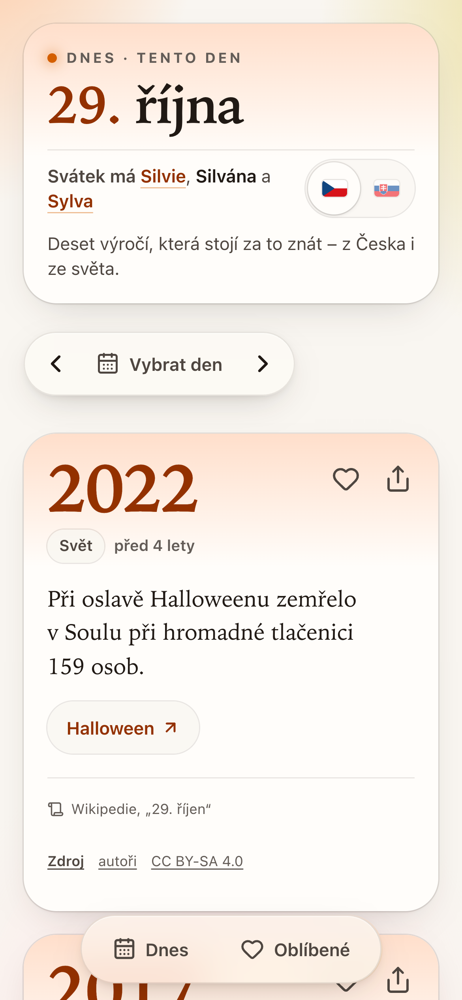
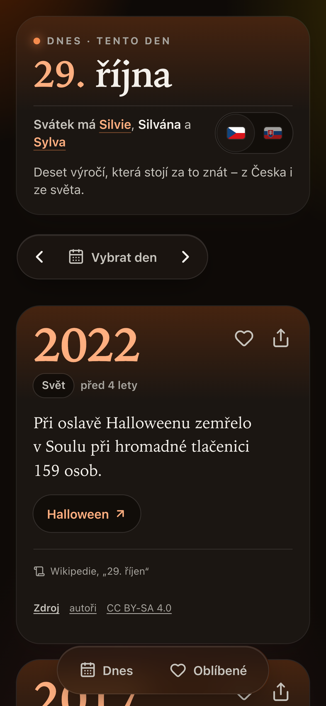
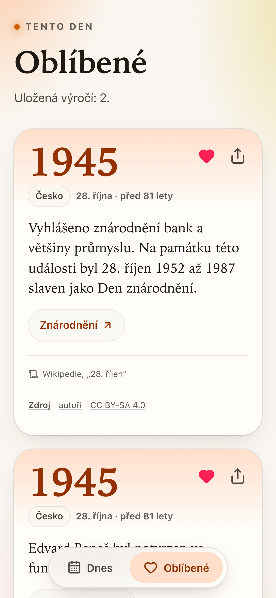
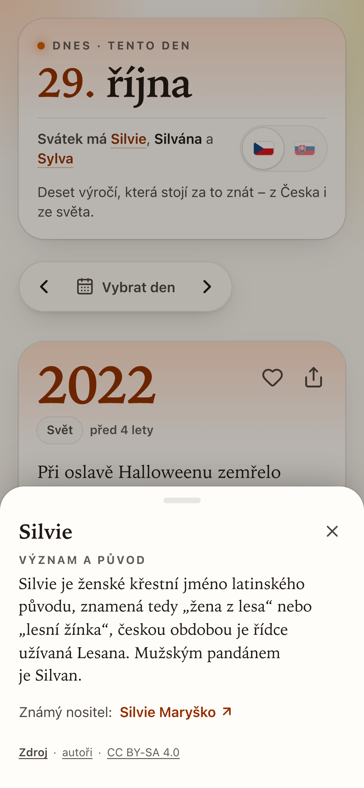
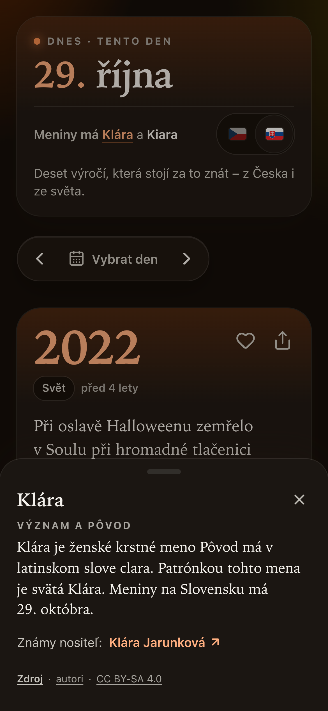
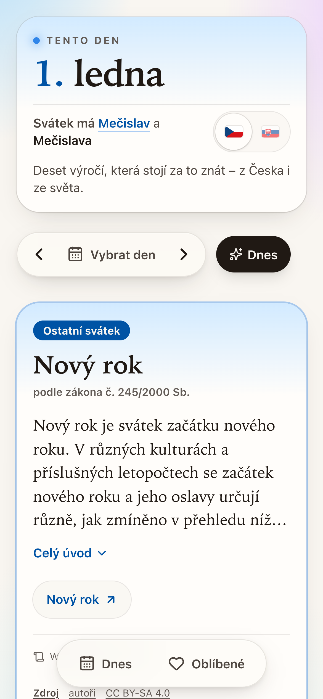
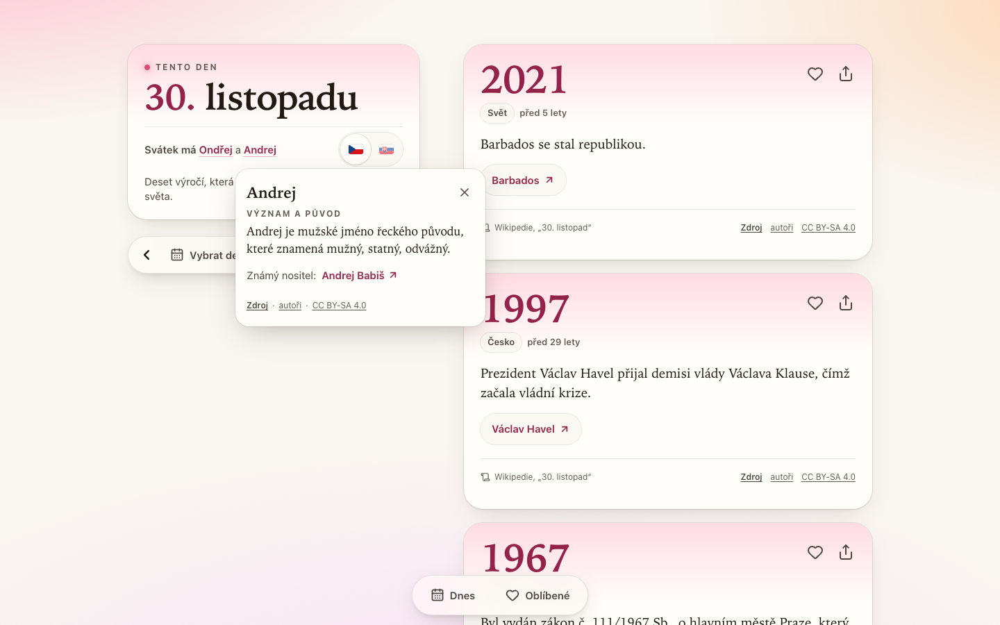
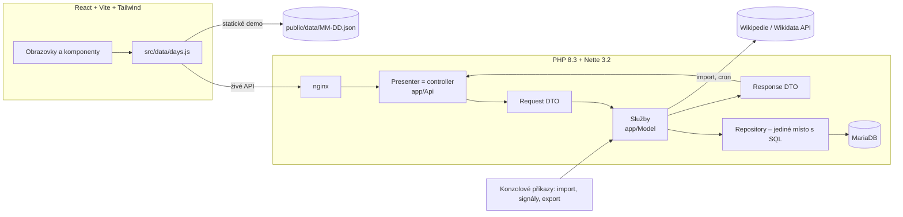

# Tento den

Každý den deset zajímavých výročí z Wikipedie – ze světa i z Česka. Mobilní webová aplikace
(PWA, hlavně iPhone v Safari) s **REST API v PHP 8.3 / Nette 3.2** a **frontendem v Reactu**.

> **Živé demo:** <https://petrstastny1.github.io/tento-den/> *(statická verze bez backendu, nasazuje GitHub Actions)*

<p>
  
  
  
</p>
<p>
  
  
  
</p>
<p>
  
</p>

## Co aplikace dělá

- Pro každý den roku vybere **10 výročí** z české Wikipedie (od starověku po současnost):
  aspoň 3 z Česka (pokud existují), jinak podle skóre; nudné události (sportovní výsledky,
  otevření obchodu, vydání softwaru…) až nakonec, rozmanitost století rozhoduje jen při
  shodném skóre. Karty jdou **od nejnovější po nejstarší**.
- **Státní svátky a významné dny** podle [zákona č. 245/2000 Sb.](https://www.zakonyprolidi.cz/cs/2000-245)
  (všech 34: státní svátky, ostatní svátky, významné dny; `backend/config/state-days.neon`).
  Připomíná-li den konkrétní událost ze stránky dne (28. 10. 1918, 17. 11. 1989…), je ta událost
  vždy v desítce, první, se štítkem „Státní svátek“ / „Významný den“ a oficiálním názvem. Den bez
  takové události (Nový rok, Vánoce, Den rodin…) má nahoře vlastní kartu s úvodem článku
  z Wikipedie; do desítky se nepočítá. Velký pátek a Velikonoční pondělí jen „dnes“, kdy je
  známý rok – při prohlížení dne a měsíce se vynechají.
- **Kulaté výročí** (25, 50, 75, 100, 150, 200, 250, 300 a dál po 100 letech; př. n. l. správně,
  rok 0 neexistuje) – nejvýš jedno denně a jen u velké události: událost státního svátku nebo
  významného dne, nebo událost, jejíž hlavní článek je sám velkou událostí (Wikidata: válka,
  revoluce, bitva, povstání, zánik státu, vyhlášení nezávislosti, mírová smlouva, let do vesmíru,
  katastrofa…), datovaný v roce události a s aspoň 60 jazykovými verzemi. Je vždy v desítce
  nahoře se štítkem „100 let“; seznam ke kontrole člověkem v [docs/vyroci.md](docs/vyroci.md),
  vyřazená v `backend/config/anniversary-exclusions.neon`.
- **Jmeniny** pod datem ve dvou režimech – **CZ** (výchozí) a **SK**, přepínač vlaječkou (volba
  se pamatuje v prohlížeči, mění jen jmeniny). CZ ze sekce „Svátky“ stránky dne na cs.wikipedia
  (stejná revize jako události), SK z věty „Meniny má …“ na stránce dne na sk.wikipedia.
  Klepnutím na jméno: význam a původ (úvod článku o jménu na Wikipedii režimu, s atribucí)
  a známý nositel (Wikidata: křestní jméno P735, státní příslušnost Česko/Slovensko/Československo,
  nejvíc jazykových verzí; odkaz na článek). Co se nenajde, se neukazuje; nic nedoplňuje AI.
- Všechny karty jsou stejně velké: rok, „před X lety“, štítek Česko / Svět, celý text
  z Wikipedie, odkaz na článek, atribuce, oblíbené a sdílení.
- Listování dny (šipky, přejetí prstem, výběr data), **sdílení karty** (Web Share API,
  jinak zkopírování odkazu), **oblíbené** v prohlížeči.
- U každé karty **zdroj na konkrétní revizi** stránky dne, odkaz na autory a licenci
  CC BY-SA 4.0. Fakta se nevymýšlí ani neupravují – text je převzatý ze zdroje.
- Všechny karty mají stejný vzhled; liší se jen textovým štítkem Česko / Svět. Příznak `sensitive`
  (oběti, války, katastrofy) zůstává v API pro budoucí AI podání, kde u tragédií nesmí být vtipy.

## Architektura



- **Backend:** Controller (Nette presenter jako API endpoint) → Service → Repository, DTO pro
  vstupy i výstupy, závislosti jen přes DI v konstruktoru, schéma jen přes migrace.
- **Import** běží jen na serveru (konzole/cron): Parsoid HTML **konkrétní revize** stránky dne,
  přísný parser (co nepřečte, shodí celý den), párování upravených vět se zachováním ID,
  nejasné změny k ruční revizi, nic se nemaže.
- **Výběr desítky (experimentální):** počet jazykových verzí článku (Wikidata) normalizovaný
  logaritmicky v rámci dne a sekce, filtr nudy jako čitelný seznam pravidel, deterministický
  výběr. Měří se na zlaté sadě a ručně hodnocených dnech ([docs/kvalita.md](docs/kvalita.md),
  [docs/experiment-vyberu.md](docs/experiment-vyberu.md)).
- **Frontend:** jedna datová vrstva se dvěma režimy (živé API / statická data), texty jen jako text,
  odkazy jen na Wikipedii. Design „almanach dne“: každý den má barvu podle ročního období,
  serifová typografie (systémové New York), skleněné plovoucí ovládání, tmavý režim, kontrast AA.

Podrobnosti a důvody: [docs/rozhodnuti.md](docs/rozhodnuti.md), zdroje dat:
[docs/zdroje.md](docs/zdroje.md), kvalita výběru: [docs/kvalita.md](docs/kvalita.md),
otázky k pohovoru: [docs/pohovor.md](docs/pohovor.md).

## Spuštění

Potřeba: Docker s Compose v2 a `make` (PHP ani Node lokálně nejsou potřeba).

```bash
make init-env            # .env s náhodnými hesly; pak doplňte WIKIMEDIA_CONTACT (e-mail do User-Agentu)
make up                  # nginx, php-fpm, MariaDB, Vite; založí i testovací DB
make migrate
make import-year         # ~10 minut: 366 stránek dnů z cs.wikipedia
make refresh-signals     # ~2 minuty: jazykové verze článků z Wikidat
make refresh-state-days  # úvody článků o svátcích bez historické události
make import-name-days-sk # ~2 minuty: slovenské jmeniny ze sk.wikipedia
make refresh-names       # ~30 minut: význam jmen a známí nositelé (Wikidata Query Service)
make classify-events     # ~1 minuta: které hlavní články jsou samy velkou událostí (kulatá výročí)
```

- aplikace: <http://localhost:8080>, API: <http://localhost:8080/api/day?date=10-28>
- statická data pro demo: `make export-static` – **export pouštět znovu na začátku každého roku**:
  kulatá výročí se počítají k roku exportu (uložený v `data/meta.json` a v každém dni jako
  `anniversaryYear`); zapíše `frontend/public/data/`, 366 souborů,
  celkem 2,5 MB, na den medián 7 kB, komprimovaně nejvýš 2 kB)
- další příkazy: `docker compose exec php php bin/console.php` (např. `events:review` – události
  čekající na ruční rozhodnutí), ověřovací reporty v `backend/bin/report/`

### API

| Metoda | Cesta | Odpověď |
|---|---|---|
| GET | `/api/day?date=MM-DD[&year=YYYY]` | `nameDays` (`cz` a `sk`: jména, význam, nositel, zdroj), `holidays` (svátky bez události) a `cards` (10 karet: připomínané události svátků první, pak od nejnovější); `year` (výchozí letošní) určuje kulatá výročí a pohyblivé svátky (ty jen s explicitním rokem nebo „dnes“); bez `date` dnešek v Europe/Prague včetně roku |
| GET | `/api/events/{id}` | jedna karta včetně stavu (`active`, `missing`, `needs_review`) |
| GET | `/api/health` | `200 {"status":"ok"}`, nebo `503` bez dostupné DB |

Jen GET (jinak 405), chyby vždy jako `{"error":{"code":…,"message":…}}`.

### Proměnné prostředí (`.env`, necommituje se)

| Proměnná | Význam |
|---|---|
| `APP_ENV` | `development` nebo `production`; jiná hodnota = aplikace nenastartuje |
| `DB_NAME`, `DB_USER`, `DB_PASSWORD` | databáze a aplikační uživatel MariaDB |
| `DB_ROOT_PASSWORD` | root heslo MariaDB, dostane ho jen kontejner databáze |
| `WIKIMEDIA_CONTACT` | kontaktní e-mail do User-Agentu požadavků na Wikimedia API |
| `HTTP_PORT`, `DB_HOST_PORT` | porty na 127.0.0.1 (výchozí 8080, 3307) |

Konfigurace se při startu validuje (Nette Schema); web s neprovedenými migracemi v produkci
nenastartuje.

## Testy a kontroly

```bash
make test    # backend (Nette Tester, testovací DB), test hygieny repozitáře, frontend (Vitest)
make lint    # PHPStan level 8, oxlint
```

Výkon (Lighthouse 12, mobilní emulace, statický build): výkon 93, přístupnost 100, Best
Practices 100, LCP 2,7 s, TBT 0 ms, CLS 0; hlavní bundle 89 kB gzip.

Testy běží offline nad uloženými odpověďmi Wikipedie (`backend/tests/fixtures/`), včetně
skutečných editací z historie stránek (přeformulování, oprava faktu, vandalismus a jeho vrácení).

## Zdroje a licence

- Texty událostí: **česká Wikipedie**, licence [CC BY-SA 4.0](https://creativecommons.org/licenses/by-sa/4.0/deed.cs).
  Wikipedie není záruka pravdivosti, ale dohledatelnosti: každá karta odkazuje na revizi
  (`oldid`), ze které text pochází, a na historii s autory.
- Jazykové verze: Wikidata (CC0). Žádné obrázky.
- Seznam svátků a významných dnů: [zákon č. 245/2000 Sb.](https://www.zakonyprolidi.cz/cs/2000-245)
  v aktuálním znění (k 13. 5. 2026); úvody karet svátků z REST `page/summary` české Wikipedie,
  s revizí a atribucí jako u událostí (CC BY-SA 4.0).
- Jmeniny: [česká Wikipedie](https://cs.wikipedia.org) (sekce „Svátky“ stránek dnů) a
  [slovenská Wikipedie](https://sk.wikipedia.org) (úvod stránek dnů), obě CC BY-SA 4.0; každý
  blok odkazuje na revizi stránky dne. Význam jmen: úvody článků z REST `page/summary` české,
  resp. slovenské Wikipedie (CC BY-SA 4.0, s revizí a autory). Známí nositelé: Wikidata (CC0)
  přes Wikidata Query Service, odkaz vede na článek na cs.wikipedia, resp. sk.wikipedia.
  Vlajky jsou vlastní zjednodušené SVG (slovenský znak zjednodušený).
- Data ve `frontend/public/data/` a fixtures v testech jsou CC BY-SA 4.0, ne licence kódu.

## Stav a plán

**Hotové:** import všech 366 dní, aktualizace se zachováním identity událostí, výběr 10 karet
se signálem z Wikidat, REST API, PWA frontend, statické demo.

**Známá omezení** (výběr karet je zatím **experimentální**):
- *Hlavní článek* události je zatím „první neobecný odkaz“ – často kulisa (stát, město) místo
  předmětu události. Signál proto měří oblibu článku, ne vždy význam události; ze „zlaté sady“
  8 známých výročí jsou v desítce svého dne 6 – dvě z nich díky státním svátkům
  ([docs/kvalita.md](docs/kvalita.md)).
- Skóre se normalizuje zvlášť pro Česko a Svět, takže nejlepší české události mají vždy kolem
  1,0 a konkurují nejlepším světovým i nad rámec tří českých míst.
- 8. 12. a 26. 12. mají jen jednu českou událost.

**Přijde:** výběr hlavního článku ověřený na hodnoticí sadě, zobrazení článků, AI podání
(vtipně edukační komentář oddělený od faktů), angličtina, offline PWA.

## Jak vznikl

Postaveno s pomocí AI asistenta (Claude Code). Zadání, architekturu, pravidla výběru a kontrolu
výstupů jsem dělal já.
